# Villa navideña animada: tutorial completo

Cómo construir, paso a paso, una villa navideña igual a las que venden en tiendas: con **luces LED**, un **río con luz azul**, un **árbol de Navidad** con luces que cambian de color y una **pista de patinaje que gira sola**.

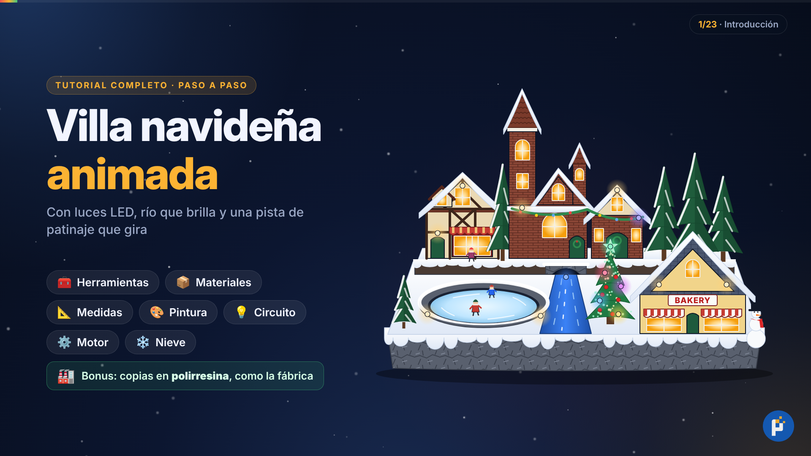

El modelo es el de la villa con **iglesia y torre, casa tudor con tienda, casa del arco, panadería ("BAKERY"), río con puente, pista de patinaje, árbol de Navidad, pinos y muñeco de nieve**.

| | |
|---|---|
| **Medidas finales** | 32 × 24 cm de base, unos 28 cm de alto hasta la punta de la torre |
| **Energía** | 5 V por cable USB (cargador de celular de 1 A) |
| **Tiempo** | 3 o 4 fines de semana (hay varios secados de una noche) |
| **Dificultad** | Intermedia: hay que soldar con cautín |
| **Video** | [`video/tutorial.mp4`](video/tutorial.mp4), unos 26 minutos, narrado en español |

---

## Contenido

1. [Cómo está hecha la de la tienda](#1-cómo-está-hecha-la-de-la-tienda)
2. [Seguridad](#2-seguridad)
3. [Herramientas](#3-herramientas)
4. [Materiales](#4-materiales)
5. [Medidas y plano](#5-medidas-y-plano)
6. [Paso a paso (etapa A)](#6-paso-a-paso-etapa-a)
7. [Pruebas y solución de problemas](#7-pruebas-y-solución-de-problemas)
8. [Etapa B (opcional): copias en polirresina, como la fábrica](#8-etapa-b-opcional-copias-en-polirresina-como-la-fábrica)
9. [Plan de trabajo](#9-plan-de-trabajo)
10. [Cómo se generó el video](#10-cómo-se-generó-el-video)

---

## 1. Cómo está hecha la de la tienda

- **Material:** polirresina, que es resina poliéster mezclada con polvo de piedra (carbonato de calcio).
- **Fabricación:** la mezcla se vacía en moldes de silicona. Por eso las casas salen **huecas** y caben luces adentro.
- **Luces:** LEDs dentro de las casas y "foquitos" visibles en las fachadas. Las luces del árbol son LEDs RGB que cambian de color solos.
- **Movimiento:** un motorreductor pequeño (un motor con engranajes que gira lento) va debajo de la pista.
- **Energía:** cable USB de 5 V o 3 pilas AA (4.5 V).
- **Acabado:** pintada a mano. La nieve es pintura blanca con escarcha.

Lo vamos a hacer en dos etapas:

- **Etapa A (obligatoria):** construyes la pieza a mano con foam, cartón pluma y masilla epóxica. Esa ya es tu villa terminada, con luces y movimiento.
- **Etapa B (opcional):** a la pieza de la etapa A le sacas moldes de silicona y vacías copias en polirresina, igual que la fábrica. Sirve para hacer varias o para venderlas.

## 2. Seguridad

- **Cúter:** usa hoja nueva y corta sobre una base de corte, con la otra mano lejos del filo.
- **Cautín:** pasa de 300 °C. Déjalo siempre en su soporte y nunca encendido solo.
- **Silicona caliente:** quema. Ten un vaso con agua fría cerca.
- **Electricidad:** todo el proyecto funciona con 5 V. **Nunca conectes nada directo al enchufe de 220 V.** No uses motores de microondas: funcionan a 220 V.
- **Foam:** no lo cortes con alambre caliente sin ventilación, porque el humo es tóxico. No le eches pintura en spray: lo derrite.
- **Resina (etapa B):** ver la [sección 8](#seguridad-con-la-resina).

## 3. Herramientas

| Para qué | Herramienta |
|---|---|
| Cortar y medir | Cúter grande, cúter de precisión (o bisturí), regla metálica, escuadra, compás, base de corte |
| Pegar | Pistola de silicona, de preferencia de **baja temperatura** (la de alta temperatura derrite el foam) |
| Electrónica | Cautín de 30 a 40 W, estaño con resina de 0.8 mm, multímetro, pelacables, alicate de corte, tubo termocontraíble |
| Perforar | Minitaladro (o taladro) con brocas de 3 y 5 mm |
| Pintar | Pinceles planos y redondos, un pincel viejo para el pincel seco, espátula pequeña, esponja, lija al agua 220 y 400 |
| Secar | Secadora de pelo |
| Etapa B | Balanza de cocina digital, vasos de plástico, palitos, respirador con filtros para vapores orgánicos, guantes de nitrilo, lentes de seguridad |

## 4. Materiales

### 4.1 Estructura

| Material | Cantidad | Para qué |
|---|---|---|
| MDF de 5 mm | 1 pieza de 32 × 24 cm | La base |
| Foam de poliestireno extruido (XPS, el que se vende como aislante) | 1 plancha de 5 cm y 1 de 2.5 cm | El terreno y el nivel de atrás. Si no lo consigues, usa tecnopor de alta densidad |
| Cartón pluma (foam board) de 5 mm | 1 pliego | Paredes de las casas y torres |
| Cartulina gruesa o cartón gris de 2 mm | 2 pliegos | Techos, agujas, tejas, marcos y vigas |
| Masilla epóxica de dos componentes (tipo Poxilina) | 1 caja | Figuras, chimeneas, punta de las agujas y adornos |
| Conos de tecnopor | 2 de 12 cm, 2 de 9 cm, 2 de 6 cm y 1 de 9 cm | Los pinos y el árbol de Navidad |
| Palitos de brocheta, mondadientes, alambre de 1 mm, clips | Unos cuantos | Troncos, clavos, armazón de figuras y patines |
| PVC espumado (sintra) de 3 mm | 1 retazo de 10 × 10 cm | El disco de la pista |
| Retazo de madera de 2 × 2 cm | 3 cm de largo | El taco donde va el motor |
| Fieltro y 4 patitas de goma | | La parte de abajo de la base |

### 4.2 Acabado

| Material | Para qué |
|---|---|
| Masilla lista para drywall (pasta muro) | Sellar el foam, nieve gruesa del borde y uniones |
| Cola sintética (goma blanca) | Pegar el foam, sellar y preparar la nieve |
| Mica transparente, celofán amarillo y papel albanene | Las 3 capas de cada ventana |
| Imprimante acrílico blanco | Base antes de pintar |
| Pinturas acrílicas: blanco, negro, siena tostada, rojo óxido, rojo bermellón, ocre, amarillo, verde hoja y azul ultramar | Todo el pintado |
| Barniz acrílico brillante | Hielo de la pista y agua del río |
| Bicarbonato de sodio | La nieve |
| Escarcha iridiscente fina | El brillo de la nieve |
| Barras de silicona transparentes | Carámbanos y agua del río |
| Cinta de pintor | Rayas de los toldos |

### 4.3 Electrónica

| Material | Cantidad | Nota |
|---|---|---|
| LED blanco cálido de 5 mm, difuso | 8 | Van dentro de las casas |
| LED blanco cálido de 3 mm, transparente | 8 | Son los "foquitos" visibles de las fachadas y la pista |
| LED RGB de cambio lento, de 2 patas, de 5 mm | 6 | Cambian de color solos (árbol, estrella y guirnalda) |
| LED azul de 5 mm | 1 | El río |
| Resistencia de 220 Ω, ¼ W (rojo-rojo-marrón) | 20 | Una por cada LED blanco o azul (se usan 17) |
| Resistencia de 100 Ω, ¼ W (marrón-negro-marrón) | 10 | Una por cada LED RGB (se usan 6) |
| Cable USB | 1 | Puede ser uno viejo: se usan solo el hilo rojo y el negro |
| Interruptor pequeño (deslizante o de balancín) | 1 | |
| Placa perforada de 5 × 7 cm | 1 | Se corta a 2.5 × 6 cm |
| Cable delgado flexible (calibre 24 a 26), rojo y negro | 5 m de cada uno | |
| Tubo termocontraíble de 2 y 3 mm | 1 m de cada uno | |
| Estaño con resina de 0.8 mm | 1 tubo | |
| Motorreductor N20 de 6 V y 10 RPM | 1 | Con su soporte (abrazadera) y una rueda para eje de 3 mm en "D" |
| Cargador de celular de 5 V y 1 A | 1 | |
| Opcional: fusible reseteable (PPTC) de 500 mA | 1 | Protección contra cortocircuitos |
| Opcional: resistencia de 22 a 47 Ω | 1 | Para que la pista gire más lento |

**Dónde comprar (si estás en Lima):** decoración, escarcha, figuras y conos de tecnopor en **Mesa Redonda**. LEDs, resistencias, motorreductor N20 y placas en las tiendas de electrónica del **Jr. Paruro**. El foam y el MDF en tiendas de construcción y mejoramiento del hogar: busca el foam como "poliestireno extruido" o "XPS". Muchas tiendas cortan el MDF a medida. El cartón pluma y la cartulina, en librerías.

## 5. Medidas y plano

**Truco:** imprime la foto de la villa a **32 cm de ancho**. Así puedes medir cada casa directamente con la regla.

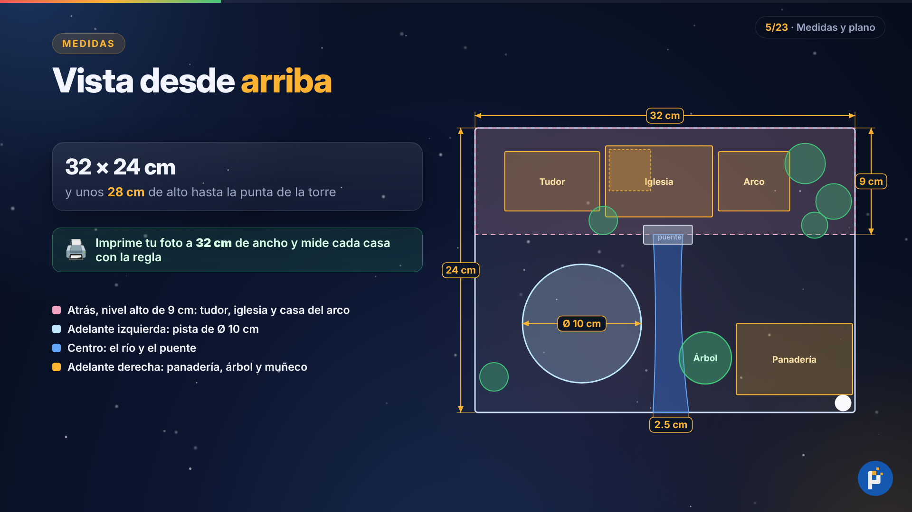

- **Atrás:** un nivel más alto, de 9 cm de fondo. Ahí van la casa tudor, la iglesia y la casa del arco.
- **Adelante a la izquierda:** la pista de patinaje, un círculo de 10 cm de diámetro con su centro a 9 cm del borde izquierdo y a 16.5 cm del borde de atrás.
- **Centro:** el río de 2.5 cm de ancho, que baja desde un puente de piedra hasta el borde delantero.
- **Adelante a la derecha:** la panadería (10 × 6 cm), con el árbol de Navidad a su izquierda y el muñeco de nieve en la esquina.

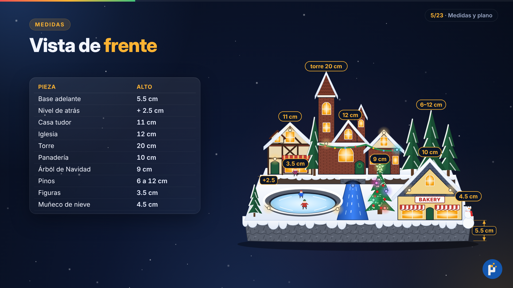

| Pieza | Medida |
|---|---|
| Base adelante (MDF + foam) | 5.5 cm de alto |
| Nivel de atrás | +2.5 cm (32 × 9 cm) |
| Casa tudor | Frente de 8 cm de ancho, 7 cm de pared, 11 cm hasta la punta · fondo 5 cm |
| Iglesia | Frente de 9 cm de ancho, 8 cm de pared, 12 cm hasta la punta · fondo 6 cm |
| Torre grande | Caja de 3.5 × 3.5 × 14 cm + aguja de 6 cm (20 cm en total) |
| Torre pequeña | Caja de 2.5 × 2.5 × 10 cm + aguja de 3 cm |
| Casa del arco | Frente de 6 cm de ancho, 7 cm de pared, 10 cm hasta la punta · fondo 5 cm |
| Panadería | Frente de 10 cm de ancho, 6 cm de pared, 10 cm hasta la punta · fondo 6 cm |
| Árbol de Navidad | 9 cm |
| Pinos | 6, 9 y 12 cm (2 de cada uno) |
| Figuras | 3.5 cm |
| Muñeco de nieve | 4.5 cm (bolitas de 22, 16 y 11 mm) |

## 6. Paso a paso (etapa A)

### Paso 1 · La base

1. Corta el MDF de **32 × 24 cm** y lija los bordes.
2. Corta el foam de 5 cm del mismo tamaño. Con foam, el cúter se pasa varias veces, sin forzar, con la hoja siempre nueva y la regla metálica como guía.
3. De la plancha de 2.5 cm, corta una franja de **32 × 9 cm**. Ese es el nivel de atrás.
4. **Todavía no pegues nada**: primero se talla.

### Paso 2 · Tallar el terreno

1. Dibuja la planta con plumón sobre el foam: casas, pista, río, árbol y panadería.
2. **Pista:** con el compás, marca un círculo de **10 cm** de diámetro y córtalo **atravesando todo el foam**. Debajo de ese hueco irán el motor y la placa de las luces.
3. **Río:** haz una canaleta de **2.5 cm** de ancho y **8 mm** de profundidad, que baje desde el nivel de atrás hasta el borde delantero.
4. **Borde de roca:** corta pedazos irregulares del borde delantero con el cúter. Luego presiona papel aluminio arrugado contra el foam para darle textura de piedra. Haz lo mismo en el frente del nivel de atrás.
5. **Por debajo:** voltea el foam y haz canales de **1 × 1 cm** para los cables. Cada canal va desde debajo de cada casa, del árbol y del puente, y todos llegan al hueco de la pista.
6. **Atrás:** abre una ranura para el interruptor y un agujero para el cable USB, unidos al hueco de la pista por un canal.
7. Pega el foam al MDF y la franja de 2.5 cm encima, con **cola sintética** y mondadientes como clavos. Pon peso encima (unos libros) y deja secar **una noche**.

### Paso 3 · Las casas

Se hacen con **cartón pluma de 5 mm**. Cada casa son 4 paredes:

- **2 frentes con forma de pentágono:** llevan la punta del techo.
- **2 laterales rectangulares:** van **entre** los frentes. Por eso miden **1 cm menos que el fondo** de la casa (el grosor de los dos cartones de 5 mm).

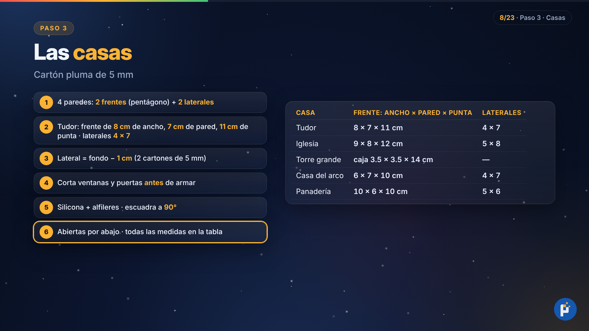

| Casa | Frente: ancho × pared × punta | Laterales |
|---|---|---|
| Tudor | 8 × 7 × 11 cm | 4 × 7 cm |
| Iglesia | 9 × 8 × 12 cm | 5 × 8 cm |
| Casa del arco | 6 × 7 × 10 cm | 4 × 7 cm |
| Panadería | 10 × 6 × 10 cm | 5 × 6 cm |

1. Dibuja las ventanas y puertas en los frentes, guiándote por la foto impresa, y **córtalas antes de armar**. Usa el cúter de precisión y corta siempre de esquina a esquina.
2. Arma las paredes con silicona y alfileres. Revisa con la escuadra que queden a **90°**.
3. **Deja las casas abiertas por abajo:** por ahí entran las luces.

### Paso 4 · Techos y torres

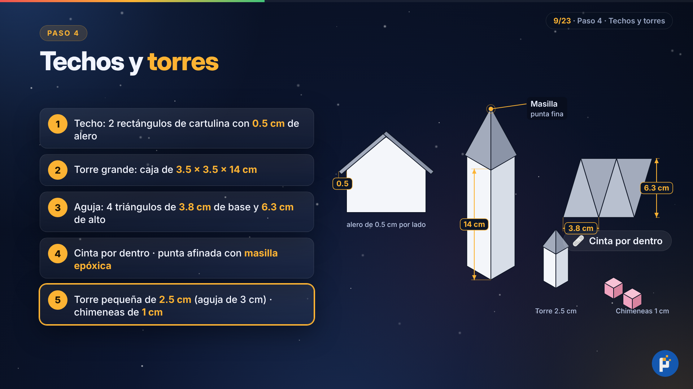

1. **Techos:** son dos rectángulos de cartulina gruesa que sobresalen **0.5 cm** por cada lado, para formar el alero.
2. **Torre grande:** caja de cartón pluma de **3.5 × 3.5 × 14 cm**, pegada a la izquierda de la iglesia.
3. **Aguja:** pirámide de cartulina hecha con 4 triángulos de **3.8 cm de base y 6.3 cm de alto**. Únelos con cinta por dentro y pon un poco de masilla epóxica en la punta para afinarla.
4. **Torre pequeña:** igual, pero de **2.5 cm** de lado, con una aguja de 3 cm.
5. **Chimeneas:** cubitos de foam de 1 cm. **Buhardilla** de la casa tudor: una mini casita de cartulina pegada sobre el techo.

### Paso 5 · Texturas

Esto es lo que hace que se vea de fábrica.

- **Ladrillos (iglesia y casa del arco):** moja un poco el papel del cartón pluma y despégalo. Raya el foam con un lapicero sin tinta: filas de **4 mm** y cortes verticales cada **8 mm**, alternados como en una pared real.
- **Vigas tudor:** tiras de cartulina de **2 mm** de ancho, pegadas en cruz y en diagonal.
- **Tejas:** tiras de cartulina de **1 cm** de alto con cortes cada **7 mm**. Se pegan de abajo hacia arriba, y cada fila tapa la mitad de la anterior.
- **Marcos de ventanas:** tiras finas de cartulina. Las barritas de la ventana son tiras de **1 mm**.
- **Toldos de la panadería y de la vitrina tudor:** cartulina doblada en ondas.
- **Letrero de la panadería:** rectángulo de **4 × 1 cm**.
- **Puerta en arco y coronas:** masilla epóxica.

### Paso 6 · Árboles

1. **Pinos:** usa conos de tecnopor de 6, 9 y 12 cm. Clava un palito de brocheta abajo como tronco y deja **1 cm** afuera, para clavarlo después en el terreno.
2. **Ramas:** forma las ramas con masilla espesa (masilla de drywall con un poco de cola). Ponla con la espátula **de abajo hacia arriba, jalando hacia abajo**, en capas, como faldas.
3. **Árbol de Navidad:** cono de 9 cm. Antes de la masilla:
   - Hazle **4 agujeros de 5 mm** para los LEDs RGB.
   - Abre un **túnel** por el centro, de la punta a la base, con una brocheta: por ahí bajan los cables.
4. **Estrella:** dibuja una estrella de 2 cm sobre papel encerado y rellénala con silicona transparente. Cuando enfríe, despégala y pégala sobre el LED de la punta.

### Paso 7 · Figuras

Puedes comprarlas hechas en tiendas de nacimientos o modelarlas con masilla epóxica.

1. **Masilla epóxica:** son dos barras. Mezcla **partes iguales** y amasa hasta que tenga un solo color. Tienes unos 15 minutos para trabajar (revisa el envase).
2. **Patinadores (2) y niño (1):** dobla un alambre como un muñequito de palitos de **3.5 cm** y cúbrelo de masilla: cuerpo, cabeza, gorro y bufanda.
3. **Patines:** pega dos trocitos de clip en los pies como cuchillas.
4. **Muñeco de nieve:** tres bolitas de **22, 16 y 11 mm**, sombrero de copa, bufanda roja y nariz de zanahoria.
5. Deja endurecer **una noche** antes de pintar.

### Paso 8 · Sellar

El foam no se pinta directo y **no acepta pintura en spray**, porque el spray lo derrite.

1. Mezcla **3 partes de masilla con 1 de cola sintética** y pásala con brocha por todo el terreno y las rocas. Así la superficie queda dura.
2. En las uniones de las casas, pasa la masilla con el dedo húmedo para que no se noten.
3. Cuando seque, lija suave y da una mano de **imprimante blanco** a todo: casas, techos, árboles y figuras.
4. Si vas a hacer la [etapa B](#8-etapa-b-opcional-copias-en-polirresina-como-la-fábrica), **este es el momento de sacar los moldes**, antes de pintar.

### Paso 9 · Pintura

Se usan tres técnicas, siempre en este orden:

1. **Capa base:** el color principal, en dos manos finas.
2. **Aguada:** 1 parte de pintura oscura (negro o marrón) por 5 de agua y una gota de lavavajilla. Se mete en las ranuras y marca las sombras.
3. **Pincel seco:** carga el pincel viejo con un color claro, quita casi toda la pintura en un papel y pásalo rápido por encima. Solo pinta los relieves.

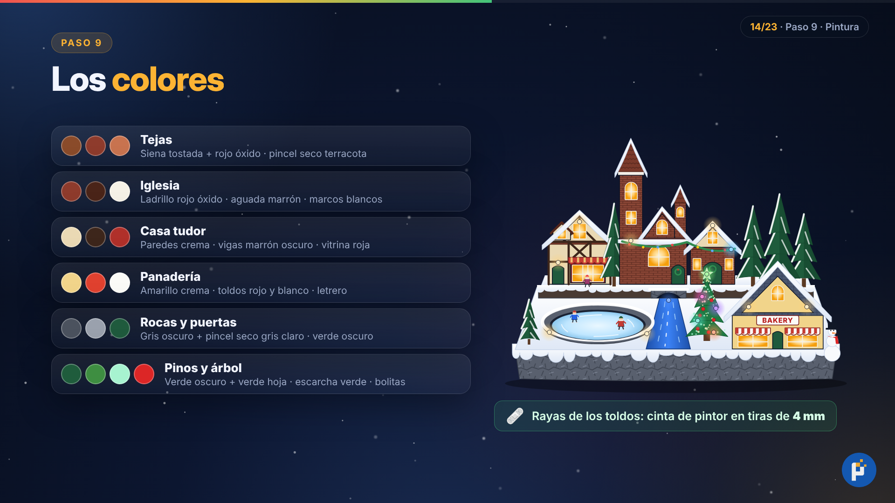

| Parte | Colores |
|---|---|
| Tejas | Siena tostada + rojo óxido, con pincel seco terracota (rojo óxido + ocre + blanco) |
| Iglesia y casa del arco | Ladrillo rojo óxido, aguada marrón oscuro y marcos blancos |
| Casa tudor | Paredes crema (blanco + ocre + una pizca de siena), vigas marrón muy oscuro (siena + negro) y vitrina con marco rojo |
| Panadería | Amarillo crema, toldos a rayas rojas y blancas, letrero blanco con letras rojas |
| Techo de la panadería | Gris azulado (negro + blanco + azul) |
| Rocas y bordes | Gris oscuro, con pincel seco gris claro y blanco |
| Puertas | Verde oscuro (verde + negro) |
| Pinos | Verde oscuro, con pincel seco verde hoja |
| Árbol de Navidad | Verde, con escarcha verde y bolitas rojas (cuentas de 3 mm) |
| Hielo de la pista | Celeste muy claro (blanco + una pizca de azul ultramar) |
| Río | Azul ultramar + negro en los bordes, azul + blanco al centro, líneas blancas de espuma |

Para las rayas de los toldos, usa cinta de pintor cortada en tiras de **4 mm**.

### Paso 10 · El mecanismo de la pista que gira

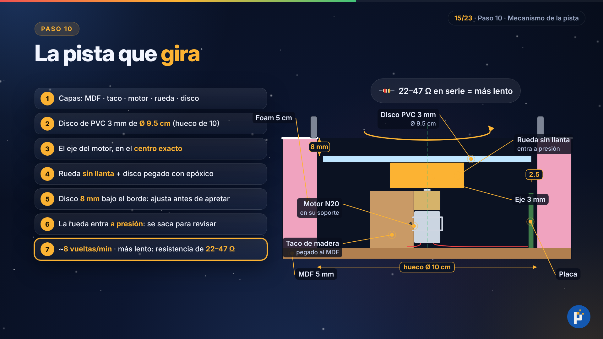

Por dentro, de abajo hacia arriba: **MDF → taco de madera → motor sujeto al costado del taco → rueda en el eje → disco de la pista**.

1. Corta el **disco** de PVC espumado de 3 mm, de **9.5 cm** de diámetro: medio centímetro menos que el hueco, para que no roce (quedan 2.5 mm de luz por lado). Marca su centro exacto.
2. Marca el **centro exacto** del hueco en el MDF con el compás. Ahí debe quedar el eje del motor, apuntando hacia arriba.
3. Pega el **taco de madera** (2 × 2 × 2.6 cm) al MDF, justo al lado de esa marca. Atornilla el soporte del motor N20 al costado del taco, con el motor parado y el eje en la marca.
4. A la **rueda** del N20 quítale la llanta de goma y pega el disco encima con pegamento epóxico (tipo Poxipol), bien centrado.
5. El disco debe quedar **8 mm por debajo del borde** de la pista. Antes de apretar los tornillos del soporte, sube o baja el motor hasta lograrlo.
6. La rueda entra **a presión** en el eje: así puedes sacar la pista cuando quieras para revisar el motor.
7. A 5 V, el motor de 10 RPM da unas **8 vueltas por minuto**. Si lo quieres más lento, ponle en serie una resistencia de **22 a 47 Ω**.

**El hielo:**

1. Pinta el disco de celeste muy claro, con curvas blancas como marcas de patines.
2. Dale **3 manos de barniz brillante**, dejando secar cada una.
3. Pega los patinadores a **3 cm del centro**, mirando hacia donde gira el disco.
4. Alrededor del hueco, haz un murito de masilla de **1 cm** de alto, píntalo como piedra y ponle nieve encima. Lleva 2 foquitos de 3 mm.

### Paso 11 · La electrónica

#### El circuito

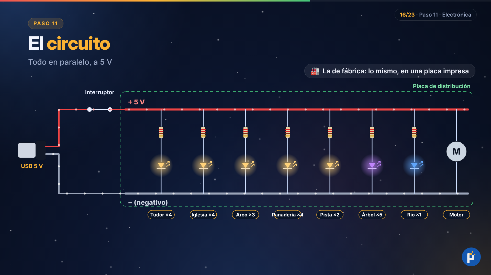

```
 USB rojo (+5 V) ──[fusible 500 mA, opcional]──[interruptor]──┬── línea + de la placa
 USB negro (−) ────────────────────────────────────────────────┴── línea − de la placa

 Entre la línea + y la línea −, todo en paralelo:
   + ──[220 Ω]──▶|── −     × 16 LEDs blanco cálido
   + ──[220 Ω]──▶|── −     × 1 LED azul (río)
   + ──[100 Ω]──▶|── −     × 6 LEDs RGB de cambio lento
   + ──( motor N20 )── −   [opcional: resistencia de 22–47 Ω en serie para más lento]
```

Todas las ramas van **en paralelo**: si un LED falla, los demás siguen prendidos.

#### Cuántos LEDs van en cada zona

| Zona | Interior 5 mm | Foquitos 3 mm | RGB | Azul | Total |
|---|---|---|---|---|---|
| Casa tudor | 2 | 2 | – | – | 4 |
| Iglesia | 3 | 1 | – | – | 4 |
| Casa del arco | 1 | 1 | 1 (guirnalda) | – | 3 |
| Panadería | 2 | 2 | – | – | 4 |
| Borde de la pista | – | 2 | – | – | 2 |
| Árbol de Navidad | – | – | 5 (4 + estrella) | – | 5 |
| Río (bajo el puente) | – | – | – | 1 | 1 |
| **Total** | **8** | **8** | **6** | **1** | **23** |

#### Las resistencias

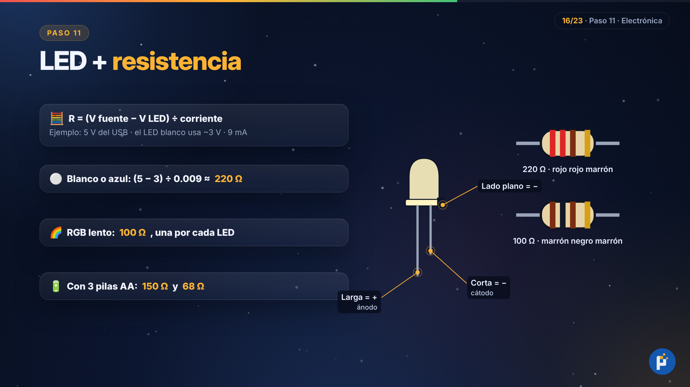

**R = (voltaje de la fuente − voltaje del LED) ÷ corriente**

| LED | Cálculo a 5 V (USB) | Resistencia | Con 3 pilas AA (4.5 V) |
|---|---|---|---|
| Blanco o azul (~3 V) | (5 − 3) ÷ 0.009 A ≈ 220 Ω | **220 Ω** (rojo-rojo-marrón) | **150 Ω** |
| RGB de cambio lento (~3.2 V) | (5 − 3.2) ÷ 0.018 A = 100 Ω | **100 Ω** (marrón-negro-marrón) | **68 Ω** |

- **Una resistencia por cada LED.** Dos RGB que comparten la misma resistencia parpadean mal.
- **Polaridad:** la pata **larga** del LED es la positiva (+). El lado **plano** de la cabeza es el negativo (−).
- **Consumo total:** unos 300 a 400 mA. Un cargador de 1 A sobra.

#### Soldar cada LED

1. Calienta el cautín y limpia la punta en la esponja húmeda.
2. Corta la pata positiva del LED a **1 cm**, tuércela con una pata de la resistencia y suelda.
3. **Cómo soldar:** apoya el cautín en la unión 2 segundos. Acerca el estaño **a la unión, no a la punta**, y retira. La soldadura debe quedar brillante, como una gota.
4. Al otro extremo de la resistencia suelda un **cable rojo**. A la pata negativa suelda un **cable negro**.
5. Cubre cada unión con termocontraíble y caliéntalo con la secadora o con el costado del cautín, sin tocarlo.
6. Deja cada LED con una cola de cables de **30 cm** y márcalo con cinta de papel ("tudor 1", "iglesia 2", etc.). Son 23 en total.

#### Probar

- **Cada LED:** conecta el cable USB al cargador y toca los cables del LED, rojo con rojo y negro con negro. Debe prender. Si no prende, está al revés o la soldadura está mal. Con el multímetro en **modo diodo** también ves la polaridad: prende suave cuando la punta roja toca la pata larga.
- **El motor:** debe girar suave, sin ruidos raros.

#### La placa de distribución

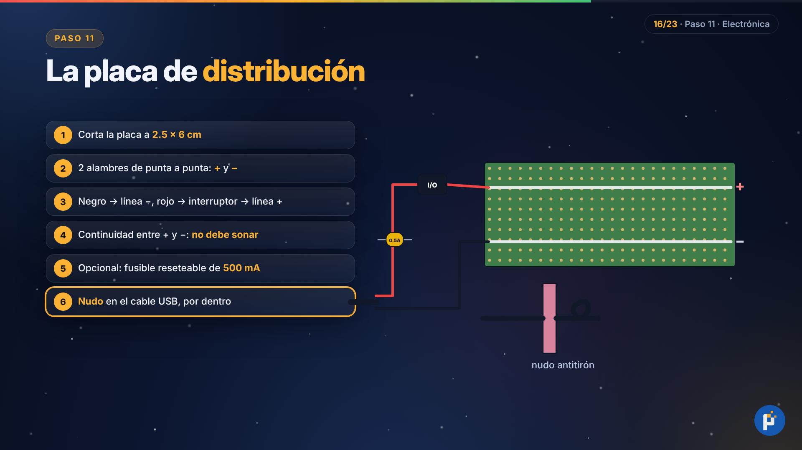

1. Corta la placa perforada a **2.5 × 6 cm**: ráyala varias veces con el cúter por una fila de agujeros y quiébrala.
2. Suelda dos alambres de punta a punta, como dos rieles. Uno es la **línea +** y el otro la **línea −**.
3. Suelda el cable USB:
   - El **negro**, directo a la línea −.
   - El **rojo**, primero al interruptor, y del interruptor a la línea +.
4. **Antes de conectar:** pon el multímetro en **continuidad** y toca las dos líneas. **No debe sonar.** Si suena, hay un cortocircuito.
5. **Opcional:** pon un fusible reseteable de **500 mA** entre el USB y el interruptor.
6. Haz un **nudo** en el cable USB por dentro de la base: así, si alguien lo jala, no se arrancan las soldaduras.

### Paso 12 · Instalar las luces y pegar las casas

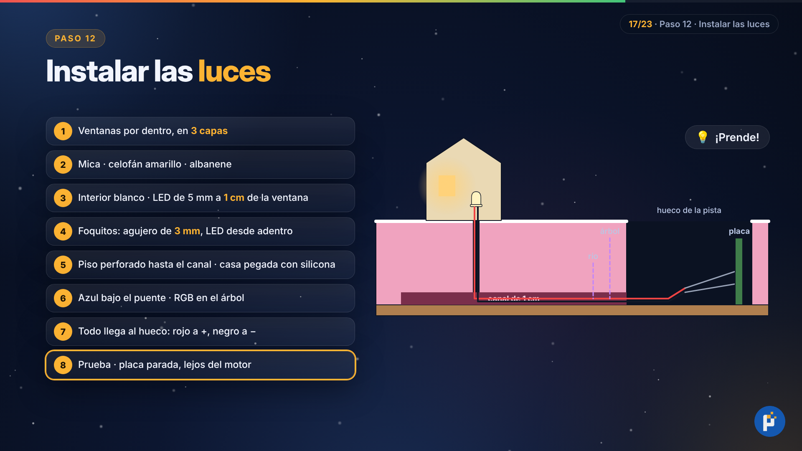

1. **Ventanas:** por dentro de cada casa, pega tres capas:
   1. **Mica transparente**, que hace de vidrio.
   2. **Celofán amarillo**, que da el tono cálido.
   3. **Papel albanene**, que esparce la luz para que no se vea el puntito del LED.
2. Pinta el interior de cada casa de **blanco**, para que la luz rebote. Si se escapa luz por las uniones, tápalas con silicona o cinta de aluminio.
3. **LEDs de 5 mm:** van adentro, pegados con silicona a una pared o a un palito, a **1 cm** de las ventanas.
4. **Foquitos de 3 mm:** haz agujeros de 3 mm en la fachada y mete los LEDs desde adentro, con la cabeza asomando.
5. **Pegar cada casa:** en su piso, perfora el foam hasta el canal de abajo, pasa los cables y pega la casa con silicona en su lugar.
6. El **LED azul** va escondido bajo el puente, apuntando al río. Los **RGB** entran en los agujeros del árbol, con sus cables por el túnel.
7. Todos los cables llegan por los canales al hueco de la pista. En la placa, suelda cada **rojo a la línea +** y cada **negro a la línea −**.
8. Prende el interruptor y revisa que todo funcione. Después pega la placa **parada contra la pared del hueco**, lejos del motor, y suelda el motor (rojo a +, negro a −; el sentido de giro no importa).

### Paso 13 · La nieve

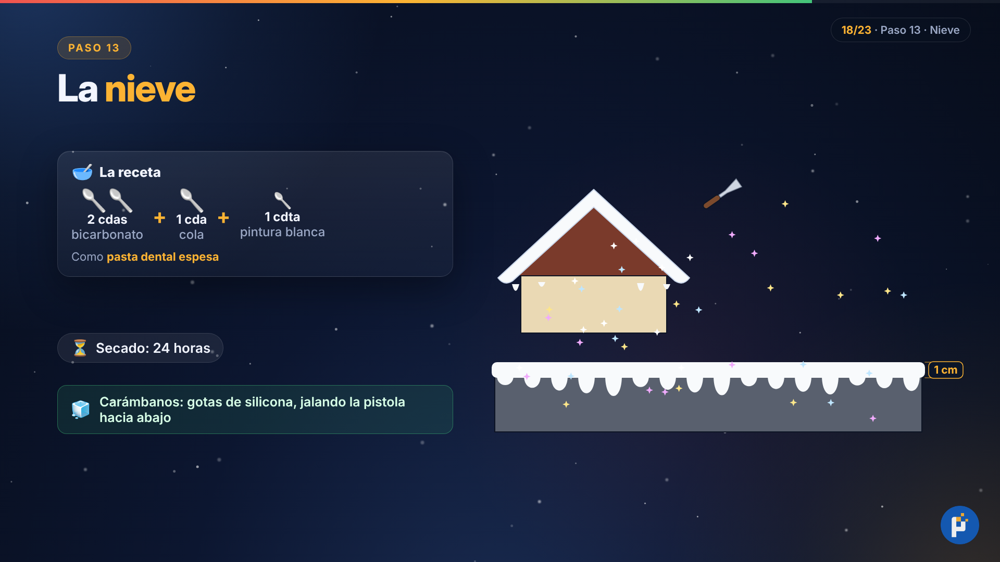

1. **Receta:** 2 cucharadas de bicarbonato, 1 de cola sintética y 1 cucharadita de pintura blanca. Debe quedar como **pasta dental espesa**.
2. Ponla con la espátula en los techos, el suelo y las rocas, con bordes redondeados como nieve acumulada.
3. En los aleros, deja que cuelgue un poco: eso hace los **bordes chorreados** de la original.
4. **Borde de la base:** lleva la nieve más gruesa, hecha con 3 partes de masilla por 1 de cola.
   1. Pon una franja de **1 cm** a lo largo del borde.
   2. Jala con el dedo hacia abajo cada 2 o 3 cm para formar las gotas, de distintos largos.
5. Mientras todo está húmedo, espolvorea la **escarcha iridiscente**. Deja secar **24 horas**.
6. **Carámbanos transparentes:** deja caer gotas de silicona desde los aleros, jalando la pistola hacia abajo.

### Paso 14 · El agua del río

1. Pinta la canaleta de azul oscuro en los bordes y azul claro al centro, con unas líneas blancas como espuma.
2. Pon tiras de silicona transparente siguiendo la corriente y caliéntalas con la secadora para que parezca agua que corre.
3. Termina con **2 manos de barniz brillante**. Con el LED azul bajo el puente, el río brilla igual que en la original.

### Paso 15 · Montaje final

1. Clava los pinos con su palito y una gota de silicona: los grandes atrás y los pequeños adelante.
2. Pega el árbol de Navidad, el muñeco de nieve en la esquina de la panadería y el niño en el nivel de atrás.
3. Pon la pista: presiona la rueda en el eje hasta el fondo y gírala con la mano para comprobar que no roce.
4. Debajo de la base, pega una lámina de **fieltro** y **4 patitas de goma**.
5. Retoca con nieve y escarcha cualquier unión o cable que se vea.

## 7. Pruebas y solución de problemas

Conecta el cargador, prende el interruptor y deja la villa funcionando **una hora**.

| Problema | Solución |
|---|---|
| Un solo LED no prende | Revisa su polaridad (pata larga a +) y su soldadura |
| No prende ninguno | Mide con el multímetro si llegan 5 V a la placa. Puede fallar el interruptor o el cable USB |
| Un LED prende muy débil | Revisa los colores de su resistencia (quizá pusiste una de más ohmios) |
| Un RGB parpadea raro | Cada RGB necesita su propia resistencia de 100 Ω |
| Se ve el puntito del LED en la ventana | Agrega otra capa de albanene o aleja el LED |
| Sale luz por las uniones de las casas | Tápalas por dentro con silicona o cinta de aluminio |
| La pista se traba o hace ruido | Está rozando: centra el disco o lija el borde del hueco |
| La pista cabecea | El disco no está centrado en la rueda: despégalo y vuelve a pegarlo |
| El foam se derritió | Le cayó spray o un pegamento con solvente: rellena con masilla y vuelve a sellar |
| La nieve se agrieta | La capa es muy gruesa: ponla en dos capas |
| El cargador se calienta | Desconéctalo: hay un cortocircuito. Revisa todo con el multímetro en continuidad |

## 8. Etapa B (opcional): copias en polirresina, como la fábrica

La idea: tu pieza **sellada** (paso 8, antes de pintar) es el modelo original. Le haces un molde de silicona y en ese molde vacías polirresina todas las veces que quieras.

- **Moldes por partes:** la fábrica no moldea todo de una vez. Haz un molde para la base, otro para cada bloque de casas, para la panadería, los árboles y las figuras.
- **Salientes:** las piezas con salientes, como los toldos, se cuelan aparte y se pegan después.

### El molde de silicona

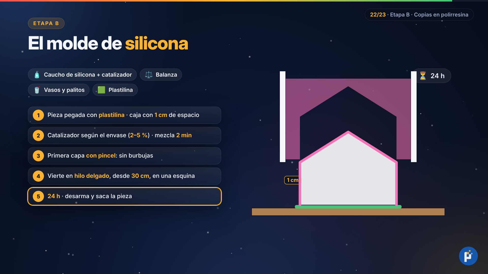

**Necesitas:** caucho de silicona para moldes (RTV) con su catalizador, balanza, vasos, palitos, plastilina y cartón pluma.

1. Pega la pieza sobre una tabla con plastilina, sellando todo el borde de abajo.
2. Arma alrededor una caja de cartón pluma, con **1 cm de espacio** entre la pieza y las paredes. Sella las esquinas con silicona caliente.
3. Pesa la silicona y agrega el catalizador que indica el envase, normalmente entre **2 y 5 %** (2 a 5 g por cada 100 g). Mezcla **2 minutos**, raspando las paredes y el fondo del vaso.
4. Primero pasa una **capa fina con pincel** sobre la pieza, para que no queden burbujas en los detalles.
5. Vierte el resto en un **hilo delgado**, desde unos **30 cm** de alto, en una esquina de la caja. Así salen las burbujas.
6. Deja curar **24 horas**, desarma la caja y saca la pieza con cuidado. El molde sirve para muchas copias.

### Colar la polirresina

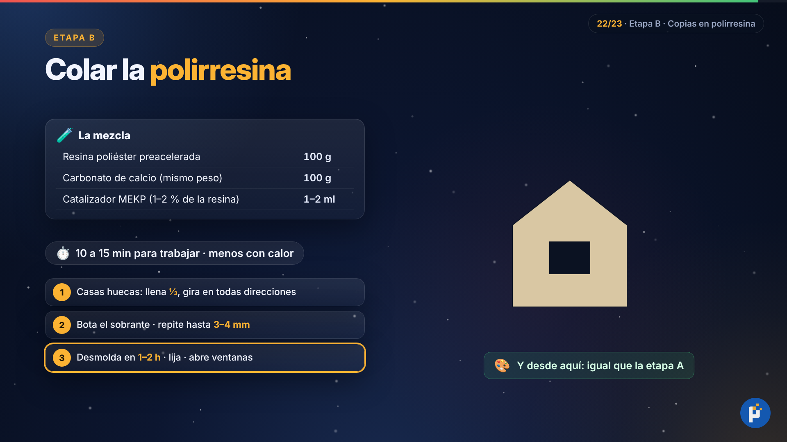

| Ingrediente | Cantidad |
|---|---|
| Resina poliéster **preacelerada** | 100 g |
| Carbonato de calcio (el mismo peso que la resina) | 100 g |
| Catalizador MEKP (1 a 2 % del peso de la resina) | 1 a 2 ml |

1. Mezcla la resina con el carbonato hasta que no quede ningún grumo.
2. Agrega el catalizador y mezcla **1 minuto**. Tienes unos **10 a 15 minutos** antes de que endurezca, y menos si hace calor.
3. **Casas (huecas):**
   1. Llena un tercio del molde y gíralo despacio en todas direcciones para cubrir las paredes.
   2. Bota el sobrante en otro vaso.
   3. Repite 2 o 3 veces, hasta tener paredes de **3 a 4 mm**.
4. **Árboles y figuras:** se llenan completos.
5. Desmolda en **1 o 2 horas**, cuando la pieza esté dura y fría. Espera 24 horas para que endurezca del todo.
6. Lija los bordes con lija al agua. Abre las ventanas con el minitaladro (o con broca y lima).
7. Desde aquí sigue igual que la etapa A: imprimante, pintura, luces, nieve y montaje.

### Seguridad con la resina

- **Vapores tóxicos (estireno):** trabaja al aire libre o con mucha ventilación, con respirador de filtros para vapores orgánicos.
- **Catalizador corrosivo, sobre todo para los ojos:** usa siempre lentes y guantes de nitrilo.
- **Nunca mezcles el catalizador (MEKP) directamente con acelerador de cobalto:** reaccionan con violencia. Por eso conviene comprar la resina ya **preacelerada**.
- **Calor:** las piezas grandes y macizas se calientan mucho al endurecer. Cuélalas en capas.
- **Desecho:** no botes resina líquida. Deja que endurezca en el vaso y después tírala a la basura.

## 9. Plan de trabajo

| Fin de semana | Pasos |
|---|---|
| 1 | Base, tallado del terreno, casas y techos (el pegado de la base seca una noche) |
| 2 | Texturas, torres, árboles, figuras, sellado e imprimante |
| 3 | Pintura, mecanismo de la pista, soldar y probar los 23 LEDs, placa de distribución |
| 4 | Instalar luces y casas, nieve (seca 24 h), río, montaje final y pruebas |

## 10. Cómo se generó el video

El video `video/tutorial.mp4` (1080p, narrado en español) se genera con `video/render.py`:

- **Escenas animadas:** hechas con HTML + GSAP (`video/escenas/`) y renderizadas cuadro a cuadro con Chromium. La villa ilustrada está en `escenas/villa.js`.
- **Voz:** el narrador es la voz neuronal [Kokoro](https://github.com/thewh1teagle/kokoro-onnx), que funciona sin internet.
- **Música:** "Noche de paz" (F. X. Gruber, 1818, dominio público), sintetizada como caja musical en el mismo script. Baja de volumen cuando habla el narrador.

```bash
pip install kokoro-onnx soundfile playwright numpy   # + ffmpeg y Chromium
mkdir -p video/modelos && cd video/modelos
curl -LO https://github.com/thewh1teagle/kokoro-onnx/releases/download/model-files-v1.1/kokoro-v1.0.onnx
curl -LO https://github.com/thewh1teagle/kokoro-onnx/releases/download/model-files-v1.1/voices-v1.0.bin
cd .. && python render.py              # tutorial.mp4 + subtitulos.srt + guion.md
python render.py --imagenes            # las imágenes de esta guía (imagenes/)
python render.py --preview --solo paso10   # capturas de una escena en video/preview/
```

Archivos generados:

- `tutorial.mp4`
- `subtitulos.srt`
- `guion.md`: la narración completa con tiempos y los capítulos para la descripción de YouTube.

El guion del video está en la lista `GUION` de `render.py`: cada frase es un subtítulo y marca cuándo aparece cada animación.
